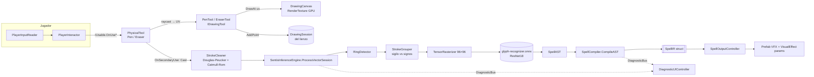

# Arquitectura

> Estado real del código al 2026-10-06. Si cambiás un contrato, actualizá este archivo.

## Pipeline de un hechizo



## Módulos (namespaces bajo `SpellSimulator.*`)

| # | Módulo | Namespace / carpeta | Clases | Responsabilidad |
|---|---|---|---|---|
| 1 | Trazado | `Canvas` | `DrawingCanvas` | `RenderTexture` por lienzo, estampado GPU con `GL` + `Graphics.DrawTexture`, interpolación Lerp, bounds de tinta, `GetUVFromWorldPosition`. Dueño de su `DrawingSession`. |
| 2 | Entrada | `Input`, `Input.Tools` | `MouseInputHandler` *(legacy)*, `IDrawingTool`, `PenTool`, `EraserTool` | Herramientas lógicas que convierten UV en trazos. `PenTool` tiene estabilizador low-pass para VR. `EraserTool` borra trazos enteros por proximidad. |
| — | Núcleo geométrico | `Core` | `Stroke`, `DrawingSession`, `StrokeCleaner`, `RingDetector`, `StrokeGrouper`, `GeometryUtils`, `SpellAST` | **Lógica pura** (estática, testeable). Limpieza, detección de anillo, agrupado sigilo/signos, rotación. |
| 3 | Inferencia | `Inference` | `SentisInferenceEngine`, `TensorRasterizer` | Orquesta ring→grupos→rasterizado→ONNX (`BackendType.GPUCompute`). Rota cada signo para que "apunte al norte" antes de inferir. Arma el `SpellAST`. |
| 4 | Compilador | `Compiler` | `SpellCompiler`, `SemanticRules`, `SpellDescriptor.cs` (`SpellIR`, enums) | Diccionario idx→nombre (JSON), clasificación sigilo/signo, deltas semánticos por signo, fórmulas de tuning portadas de `spellBuilder.ts`. |
| 5 | Salida | `Output` | `SpellOutputController` | Elige prefab por `ElementType`, escala, setea floats exposed del VFX Graph (`Force`, `Spread`, `Focus`, `Range`, `Gravity`, `Duration`, `Stability`, `Quality`, `Strength`, `Direction`) y destruye a `duration + 0.5s`. |
| 6 | Sandbox | — | *(no implementado)* | Rigidbodies, fuerzas, `Flammable`, ragdolls. |
| — | Jugador | `Player` | `PlatformDetector`, `PlayerInputReader`, `PlayerMovement`, `PlayerLook`, `PlayerInteractor` | Rig PC/VR, input por código (Input System), movimiento por fuerzas, agarrar/soltar/usar. |
| — | Mundo | `World` | `PhysicalTool`, `PhysicalCanvas` | Objetos agarrables (`IInteractable`) y usables (`IUsable`). |
| — | Interfaces | `Interfaces` | `IInteractable`, `IUsable`, `HandType` | Contratos jugador ↔ objetos. |
| — | Debug | `DebugTools` | `DiagnosticBus` (eventos estáticos), `DiagnosticUIController` | Muestra tensor 96×96, top‑3 predicciones y log del compilador. |

## Contratos clave

- `DrawingCanvas.DrawAt(Vector2 uv, bool isNewStroke)` — el lienzo no sabe de dónde viene la UV.
- `IDrawingTool.Initialize(DrawingSession)` + `OnPointerDown/Drag/Up(uv, canvas)`.
- `IInteractable { PreferredHand; OnInteract(Transform holdPoint); OnDrop(); }` — `Left` = lienzos, `Right` = herramientas.
- `IUsable { OnUseStart/Hold/End(); OnSecondaryUseStart(); }` — Pen: secundario = **Cast**; Eraser: secundario = **Undo**.
- `SentisInferenceEngine.ProcessVectorSession(DrawingSession cleaned)` — punto de entrada del reconocimiento.
- `SpellCompiler.CompileAST(SpellAST, bool active) → SpellIR`.
- `SpellOutputController.SpawnSpellEffect(SpellIR, Vector3 pos)`.
- `PlatformDetector.IsVR` (static) — **único** lugar con lógica de plataforma.

## Input (PlayerInputReader, sin `.inputactions`)

| Acción | PC | Gamepad | VR (OpenXR) |
|---|---|---|---|
| Move | WASD | Left stick | Left thumbstick |
| Look | Mouse delta | Right stick | (head tracking) |
| Jump | Space | South | — |
| Interact (agarrar/soltar) | E | Right trigger | Right grip |
| UseTool (dibujar) | Click izq. | Left trigger | Right trigger |
| SecondaryUse (cast/undo) | Click der. | East | Right A |

## Escena `Assets/_Project/Scenes/Escena.unity` (única en Build Settings)

```
CinemachineCamera
Directional Light
EventSystem
Canvas (UI)  ─ HUD (Cast/Clear/Undo/Pen/Eraser inactivos, Crosshair) ─ DEBUG (Text-Predictions, Text-Compiler, RawImage) [DiagnosticUIController]
SystemManagers [SentisInferenceEngine, SpellCompiler, SpellOutputController, MouseInputHandler]
PaperCanvas    (layer 6) [DrawingCanvas, PhysicalCanvas]
Player         [PlatformDetector, PlayerInputReader, PlayerMovement, PlayerLook, PlayerInteractor]
  ├─ PCRIG  (CameraRootPC, ManoDerechaPC, ManoIzquierdaPC)
  └─ VRRIG  (XR Interaction Manager, XR Origin (VR))
Pen / Eraser   (layer 7) [PhysicalTool] ─ RaycastTool (origen del rayo VR)
Floor
```

Layers: 6 = lienzo (canvasLayer), 7 = herramientas.

## Paquetes relevantes
`com.unity.ai.inference` 2.6.1 (Sentis), `render-pipelines.universal` 17.3, `visualeffectgraph` 17.3,
`inputsystem` 1.19, `xr.openxr` 1.16.1, `xr.interaction.toolkit` 3.3.2, `xr.hands` 1.7.3, `cinemachine` 3.1.7,
`test-framework` 1.6. Unity MCP (`com.unity.ai.assistant`) para el harness.

## Puntos de extensión previstos
- **Nuevo elemento**: agregar a `ElementType`, `GlyphToElement`, `SelectPrefab` y prefab VFX. Ver [[GLYPHS]].
- **Nuevo signo**: `SignIds` + `SignSemantics` (deltas) + opcional regla en `SemanticRules.ApplySign`.
- **Nueva herramienta**: implementar `IDrawingTool` y ampliar `PhysicalTool.ToolKind`.
- **Objeto agarrable**: implementar `IInteractable` (+ `IUsable` si tiene uso).
