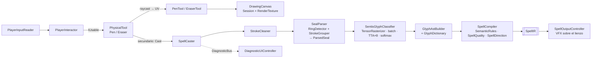

# Arquitectura

> Estado al 2026-10-07 (reestructura del pipeline). Si cambiás un contrato, actualizá este archivo.

## Pipeline de un hechizo



Todo entre `SpellCaster` y `SpellIR` es **lógica pura** (estática, testeada) excepto el clasificador.

## Módulos (`Assets/_Project/Scripts/<Modulo>/`, namespace `SpellSimulator.<Modulo>`)

| Módulo | Clases | Responsabilidad |
|---|---|---|
| `Core` | `Stroke`, `DrawingSession`, `GeometryUtils`, `StrokeCleaner`, `InkReservoir` | Datos de trazo y geometría 2D. Ángulos en grados matemáticos con Y arriba (como la referencia). |
| `Canvas` | `DrawingCanvas` | Dueño de su `Session` (UV) y de una `RenderTexture`. `DrawAt`, `Redraw`, `Clear`, `GetUVFromWorldPosition`, `UvToIsotropic`, `SurfaceNormalLocal`. |
| `Input.Tools` | `IDrawingTool`, `PenTool`, `EraserTool`, `RagTool` | Editan la sesión del lienzo desde UV. Pen con estabilizador exponencial; Eraser con radio en metros. |
| `Parsing` | `RingDetector`, `RingInfo`, `StrokeGrouper`, `SymbolCandidate`, `RingLayers`, `SealParser`, `ParsedSeal` | Geometría del sello: ajuste de círculo (Kasa), cobertura angular → anillo cerrado/abierto, capas radiales, candidatos con métricas (`sizeNorm`, `radiusNorm`, `angleDeg`, orientación, forma). |
| `Recognition` | `TensorRasterizer`, `GlyphClassifier` (puro, testeable), `SentisGlyphClassifier` (componente), `IGlyphClassifier`, `GlyphPrediction`, `ClassificationMath` | Rasterizado idéntico al de entrenamiento, inferencia por lotes, TTA de 8 rotaciones, softmax. |
| `Glyphs` | `GlyphDictionary`, `GlyphEntry`, `GlyphSemantic`, `GlyphDictionaryAsset` | Diccionario como **datos** (JSON de la referencia) → rol, elemento, tamaño de referencia, capas permitidas, semántica, plantillas. |
| `Compiler` | `GlyphAST`, `GlyphAstBuilder`, `GlyphWarnings`, `SpellCompiler`, `SemanticRules`, `SpellQuality`, `SpellDirection`, `SpellIR` | Port fiel de `compiler/` de la referencia (sin la capa Plan). |
| `Casting` | `SpellCaster`, `SealActivation`, `SealReader` (lectura guiada: prueba agrupaciones y elige la que el modelo entiende) | **Único punto de entrada** para lanzar: auto-activación al cerrar el anillo, fases del sello, orquesta el pipeline, diagnósticos, eventos `SpellCompiled` / `SealPhaseChanged`. |
| `Output` | `SpellOutputController`, `SealFeedback` (pulso de preparado y destello en el papel) | Prefab por elemento, sobre el lienzo, orientado por `direction` (papel → mundo), parámetros al VFX Graph. |
| `Player` | `PlatformDetector`, `PlayerInputReader`, `PlayerMovement`, `PlayerLook`, `PlayerInteractor` (recarga de tinta), `InkSupply`, `Haptics` | Rig PC/VR, input por código, agarrar/soltar/usar por mano. |
| `World` | `PhysicalTool` (lápiz, goma, trapo; tinta), `PhysicalCanvas`, `Inkwell` | Objetos agarrables/usables. |
| `Interfaces` | `IInteractable`, `IUsable`, `HandType`, `IInkUser`, `IInkSource` | Contratos jugador ↔ objetos. |
| `Debug` (`DebugTools`) | `DiagnosticBus`, `DiagnosticUIController` | Tensor, top‑3 y log del compilador en la UI. |

Dependencias (sin ciclos): `Core` ← `Parsing` ← `Compiler` → `Recognition`, `Glyphs`; `Casting` usa todo; `World` → `Casting`; nada depende de `World`/`Player` salvo `World`.

## Contratos clave

- `SpellCaster.OnStrokeFinished(canvas)`: al terminar un trazo de tinta evalúa el sello y, si el anillo quedó cerrado,
  **lanza** (canon). `OnSealEdited(canvas)` tras borrar o deshacer (nunca lanza). Fases en `SealActivation`:
  `Drawing → Prepared (anillo abierto) → Spent (lanzado)`; reabrir el anillo rearma el sello. Evento `SealPhaseChanged`.
- `SpellCaster.Cast(DrawingCanvas) → SpellIR` (+ evento `SpellCompiled`): compila y lanza sin mirar la fase.
- `IGlyphClassifier.Classify(IReadOnlyList<DrawingSession>) → GlyphPrediction[]` (probabilidades por candidato).
- `SealParser.Parse(DrawingSession) → ParsedSeal`; orden de candidatos: sigilo central primero, luego signos.
- `GlyphAstBuilder.Build(ParsedSeal, predicciones, GlyphDictionary) → GlyphAST`.
- `SpellCompiler.Compile(GlyphAST, float time) → SpellIR`.
- `SpellOutputController.SpawnSpellEffect(SpellIR, Transform lienzo, Vector3 normalLocal)`.
- `DrawingCanvas.Redraw()` repinta desde `Session` (**no** la borra); `Clear()` borra todo.
- `PlatformDetector.IsVR` / `IsLookCaptured` — único lugar con lógica de plataforma.

## Reglas del sello (de la referencia)

| Regla | Detalle |
|---|---|
| Anillo obligatorio | Sin anillo → inválido (`no_ring_detected`). |
| Activo = anillo cerrado | Cobertura ≥ 98.5%, o ≥ 90% con extremos a < 0.2 r. Abierto (≥ 52%) → **preparado**: válido pero no se lanza. |
| Capas | centro ≤ 0.32 r · medio ≤ 0.66 · exterior ≤ 0.94 · borde ≤ 1.06. Cada glifo tiene `allowedLayers`. |
| Sigilo | Trazos con centro de masa ≤ 0.40 r forman un candidato. Un solo sigilo; confianza ≥ 0.62. |
| Signos | Resto de trazos agrupados por proximidad (union-find, 0.12 r). Reconocidos con confianza ≥ 0.48. |
| Parámetros | Base + semántica del sigilo + Σ(semántica del signo × influencia) + calidad. Influencia = confianza × prolijidad × tamaño × largo × capa × distancia. |
| Dirección | Suma de direcciones de signos (`position` / `inward` / `orientation`), inclinada desde la normal según `force` (máx 76°). |

## Input (PlayerInputReader)

| Acción | PC | Gamepad | VR (OpenXR) |
|---|---|---|---|
| Move | WASD | Left stick | Left thumbstick |
| Look | Mouse | Right stick | (head tracking) |
| Jump | Space | South | — |
| Interact (agarrar/soltar) | E | Right trigger | Right grip |
| UseTool (dibujar/borrar) | Click izq. | Left trigger | Right trigger |
| SecondaryUse (deshacer) | Click der. | East | A |
| Recargar tinta | R (mirando un tintero, con uno en la mano o de la reserva) | West | Mojar la punta en un tintero |
| Liberar cursor | Escape (click recaptura) | — | — |

## Escena `Escena.unity`

```
CinemachineCamera · Directional Light · EventSystem
Canvas (UI) ─ HUD (Crosshair) ─ DEBUG [DiagnosticUIController]
SystemManagers [SentisGlyphClassifier, SpellCaster, SpellOutputController]
PaperCanvas (layer 6) [DrawingCanvas, PhysicalCanvas, SealFeedback]
Player [PlatformDetector, PlayerInputReader, PlayerMovement, PlayerLook, PlayerInteractor, InkSupply] ─ PCRIG / VRRIG
Pen, Eraser, Rag (layer 7) [PhysicalTool → SpellCaster] ─ RaycastTool
Inkwell [Inkwell]
Floor
```

## Puntos de extensión
- **Nuevo glifo / cambiar semántica**: editar JSON (o sync desde la referencia) → `SpellSimulator/Dictionary/Rebuild Asset`. Sin tocar código.
- **Nuevo elemento**: `ElementType` + `SpellIR.ParseElement` + prefab en `SpellOutputController`.
- **Otro reconocedor** (CPU, otro modelo): implementar `IGlyphClassifier`.
- **Nueva herramienta**: `IDrawingTool` + `PhysicalTool.ToolKind`.
- **Reaccionar a hechizos** (sandbox, hápticos, sonido): suscribirse a `SpellCaster.SpellCompiled`.
