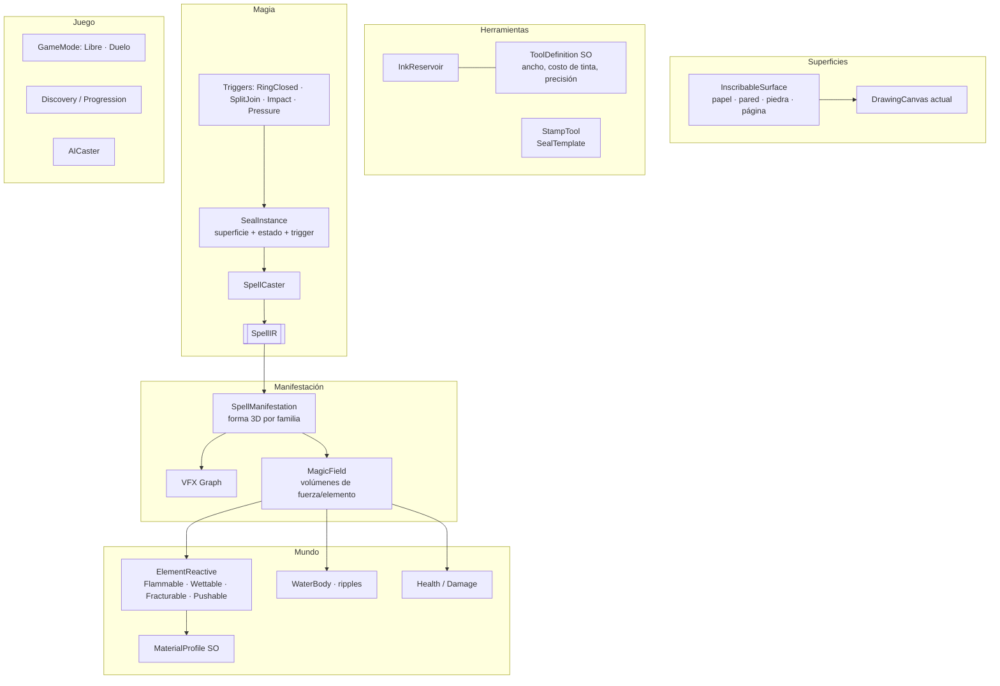

# Diseño de sistemas (arquitectura objetivo)

Cómo se construye [[GAME_DESIGN]] sobre la arquitectura actual ([[ARCHITECTURE]]). Principios:
- **Datos, no código**: herramientas, materiales, reacciones, daño y progresión son ScriptableObjects o JSON.
- **El pipeline mágico no se toca**: `SpellCaster` produce un `SpellIR`. Todo lo nuevo *consume* el IR
  (evento `SpellCompiled`) o *alimenta* superficies.
- **Quest es el piso**: nada por frame que aloque, simulaciones por *ticks* y presupuestos explícitos.
- **Separación modelo / presentación**, para poder agregar red (online) sin reescribir.

## Mapa de módulos nuevos

## 1. Superficies inscribibles
**Hoy:** `DrawingCanvas` = un Quad con RenderTexture.
**Objetivo:** `InscribableSurface` (componente) para papeles, páginas, paredes, mesas y piedras.
- Papel y página: mesh plano + RT (como hoy).
- Paredes, mesas y piedras: un **URP Decal Projector** que proyecta una RT local en el punto donde se empieza a
  dibujar. Cada sello es un "parche" (RT de 256–512) con su propio frame (origen, normal, escala en metros).
- Cada sello tiene **tamaño físico** (radio del anillo en metros) ⇒ alimenta la ley extensiva (caudal ∝ R²).
- `SealInstance`: sesión + frame + estado (`Drawing | Prepared | Active | Spent | Broken`) + trigger + tinta usada.
- Daño a la superficie: quemar o mojar ⇒ `SealInstance.Break()` (romper el sello del canon).

## 2. Herramientas y tinta
- `ToolDefinition` (SO): tipo (`Pen | Brush | Chisel | Eraser | Rag | Stamp`), ancho de trazo, costo de tinta por
  metro, estabilizador, precisión (ruido) y si requiere superficie de piedra.
- `IDrawingTool` actual se mantiene. `PhysicalTool` lee un `ToolDefinition` (hecho en M2: ancho, tinta, estabilizador;
  falta precisión/ruido y los tipos Chisel/Stamp). Cada `Stroke` guarda su ancho en metros: el reconocimiento no lo usa.
- `InkReservoir` (en la herramienta): capacidad y nivel. Dibujar consume según la **longitud en metros**; sin tinta
  no se dibuja (el trazo "se seca").
- `Inkwell` (objeto): reserva grande. Recarga por contacto de la punta (VR) o con `R` si está en el inventario (PC).
- **Trapo**: `IDrawingTool` que limpia toda la superficie al frotar (umbral de recorrido).
- **Piedra de rayar**: igual que el lápiz, pero sólo sobre materiales `Carvable`; el sello queda `Permanent`.

## 3. Sellos, estampas y contraptions
- `SealTemplate` (SO o runtime): trazos normalizados de un glifo o de un sello completo (anillo + sigilo + signos).
  Sale del diccionario (`GlyphEntry.TemplateStrokes`) o de un sello dibujado por el jugador ("guardar sello").
- **Estampa**: secundario contra una página del libro ⇒ copia un `SealTemplate`. Primario contra una superficie ⇒
  escribe los trazos escalados al tamaño de la estampa (S/M/L) en la sesión. **El anillo se estampa abierto** (canon de
  la referencia): queda preparado y se cierra a mano. Opcional: estampas "completas" para el duelo.
- **Triggers** (`ISealTrigger`): `RingClosed` (default), `SplitJoin` (dos medias lunas en dos objetos; se activa con
  distancia < ε y orientación alineada ⇒ se fusionan las sesiones), `Impact` (lanzables: velocidad relativa > umbral),
  `Pressure` (pisar o apoyar) y, a futuro, `Timer`.
- **Contraption**: cualquier objeto con `InscribableSurface` + `SealInstance` + trigger. Puede ser persistente
  (`Permanent`, con cooldown) o de un solo uso.

## 4. Manifestación del hechizo en 3D
**Hoy:** se instancia un prefab por elemento y se pasan floats al VFX Graph.
**Objetivo:** `SpellManifestation`, un componente que ejecuta la *forma* del hechizo:
- Una **familia por manifestación** (`aura`, `column`, `dispersion`, `levitation`, `pull`, `convergence`, `region`,
  `orb`...), cada una con un `ManifestationProfile` (SO). Es el lugar natural para portar la **capa Plan** de la
  referencia (KI-023).
- Escala física: radio del sello en metros × `effectScale`; caudal ∝ R² × quality (ley extensiva).
- Produce **dos salidas**:
  1. Visual: VFX Graph + luces + decals, con los parámetros del IR.
  2. Física: uno o varios `MagicField` (volúmenes) con forma (esfera, cono, cilindro o cápsula en movimiento),
     elemento, intensidad, velocidad del flujo y duración.
- **Presupuesto**: máximo N manifestaciones activas y M partículas totales; las más viejas se apagan con fade.

## 5. Mundo reactivo
> **Estado (M4, 2026-10-07):** hecho el núcleo — `MagicWorld`, `ElementReactive`, `MaterialProfile`, `ReactionTable`,
> fuego, agua, viento, impacto, fractura por grilla y reinicio; estanque (`WaterVolume`) con ondas analíticas en shader
> (sin RT, 16 ondas), flotación por material, vapor y succión. Suelo: marcas por elemento y rocas que emergen. Muñecos con vida (`Combat`). Faltan el lago grande y la pre-fractura.

- `MagicField` no busca objetos por frame: un **MagicWorld** hace *ticks* a 10–20 Hz con `Physics.OverlapXNonAlloc`
  (buffers preasignados) y despacha a los componentes reactivos.
- `ElementReactive` + `MaterialProfile` (SO por material: madera, piedra, papel, tela, agua, metal) con sus
  propiedades: inflamable (temperatura de ignición, tiempo de quemado), mojable, fracturable (umbral de fuerza),
  masa y absorción.
- **Matriz de reacciones** (`ReactionTable` SO): elemento × material ⇒ efectos. Ver [[MAGIC_SYSTEM#5. Elementos × mundo (matriz de reacciones)]].
- **Fuego**: `Flammable` con temperatura. Propaga a sus vecinos por tick. Lo apagan el agua y la lluvia; el viento lo
  aviva. Al quemarse por completo: material carbonizado y luego fractura o destrucción.
- **Fractura**: meshes **pre-fracturados** offline (herramienta de editor con Voronoi o paquete open-source tipo
  OpenFracture). En runtime se cambia el objeto intacto por los fragmentos con impulso. Pool de fragmentos y
  despawn por presupuesto.
- **Suelo**: cráteres con decals + rocas emergentes (prefabs); deformación real del terreno sólo en PC si alcanza (KI futuro).
- **Agua**: shader estilizado + **ripples por GPU** (RT de simulación de altura, impulsos desde los campos), splashes
  con VFX, flotación simple (fuerza por punto sumergido) y evaporación (vapor VFX + reducción visual local).
- **Viento**: `MagicField` de tipo flujo ⇒ `AddForce` a Rigidbodies, olas en el agua y fuego avivado.

## 6. Daño y vida (Duelo, y dummies en Libre)
> **Estado (M4):** `Health`, `DamageTable`, `DamageModel`, `ImpactDamage`, números flotantes y `TrainingDummy`.
> Faltan escudos (`MagicBlocker`) y la vida del jugador (Duelo).
- `Health` + `DamageReceiver`. Daño = f(elemento, intensidad del campo, tiempo de exposición o impacto, quality).
  La tabla de daño es un SO para balancear sin tocar código.
- Escudos: manifestaciones de tierra o agua que bloquean campos (el campo se recorta contra colliders "MagicBlocker").

## 7. Progresión y descubrimiento
- `DiscoveryState` (guardado local, JSON): glifos descubiertos y libros leídos.
- `Book` (objeto): al leerlo (abrir y pasar páginas) descubre glifos ⇒ el libro-menú los muestra.
- Descubrir por experimentación: si `SpellCaster` reconoce un glifo no descubierto con confianza alta ⇒ se descubre.
- El reconocimiento **no** se bloquea por progresión (decisión: los glifos sin descubrir funcionan).

## 8. Modos de juego y red
- `GameMode` (SO + escena): Libre (sin daño, con reinicio del mundo) y Duelo (timer, vida, tinta, mazo de sellos, IA).
- **Preparado para red**: el estado autoritativo (sesiones de trazos, sellos, vida, campos) se separa de la
  presentación. Lo que viaja por red son **trazos y eventos de cast**, no partículas. A futuro: Netcode for
  GameObjects + Relay. No se implementa hasta la fase de online.
- `AICaster`: elige un `SealTemplate` según la táctica, lo "dibuja" con velocidad y ruido configurables (dificultad)
  sobre su superficie y pasa por el **mismo** `SpellCaster`. Cero atajos: la IA juega con las mismas reglas.

## 9. Libro-menú (UI diegética)
- Objeto con páginas (World-space UI Toolkit o mallas con RT). Secciones: glifos descubiertos (plantilla + animación
  de trazo + explicación), sellos guardados, opciones (calidad, sensibilidad, PC/VR), modo y reinicio.
- La página de un glifo es una `InscribableSurface` de solo lectura ⇒ la estampa la puede "cargar".

## 10. Presupuestos de rendimiento (Quest 3, 72/90 Hz)
| Recurso | Presupuesto inicial |
|---|---|
| Manifestaciones activas | 6 |
| Partículas VFX totales | ~20k (GPU) |
| Rigidbodies dinámicos activos | 150 |
| Fragmentos de fractura vivos | 120 (pool) |
| Ticks del MagicWorld | 15 Hz |
| Inferencia por cast | < 30 ms (medir: TTA ×8 vs ×1) |
| RTs de sellos | 512² para papel, 256² para decals |

## Riesgos
- **Decals de tinta sobre superficies arbitrarias**: lo más técnico. Mitigación: empezar con papeles y páginas (lo que
  ya funciona) y dejar paredes y piedras para un hito posterior.
- **Fractura + física en Quest**: limitar con pools y presupuestos; LODs agresivos.
- **Feel del dibujo en VR**: el contacto de la punta con la superficie (no sólo el rayo) es clave. Prototipar temprano.
- **Alcance**: el modo Duelo duplica el contenido. Por eso va después del Libre.
